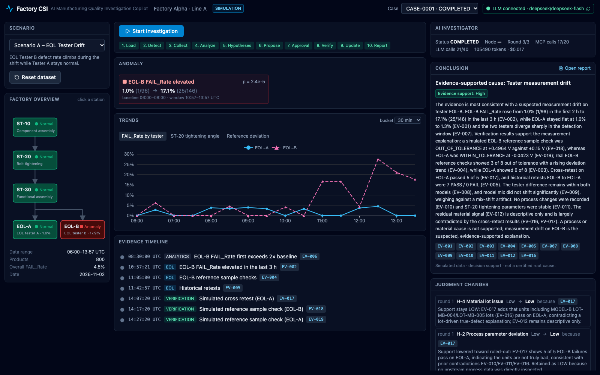
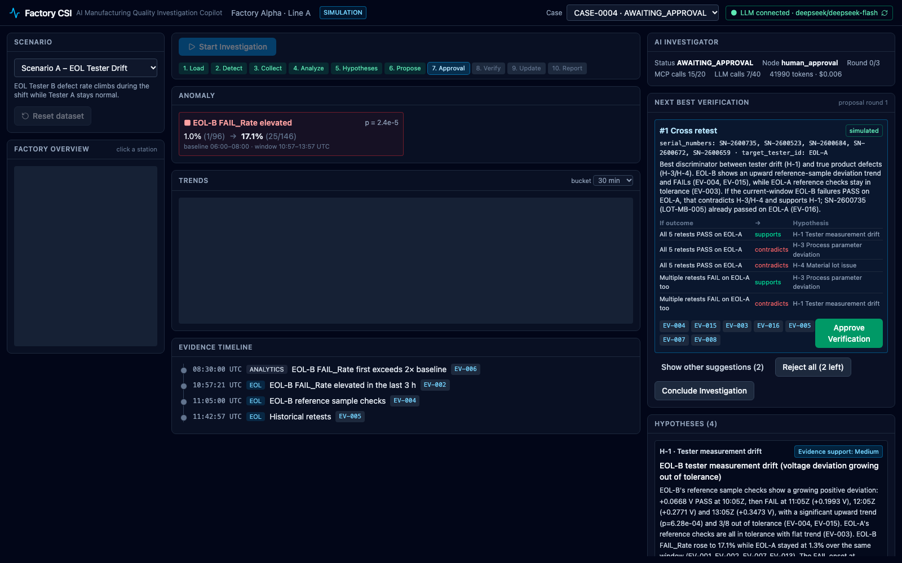
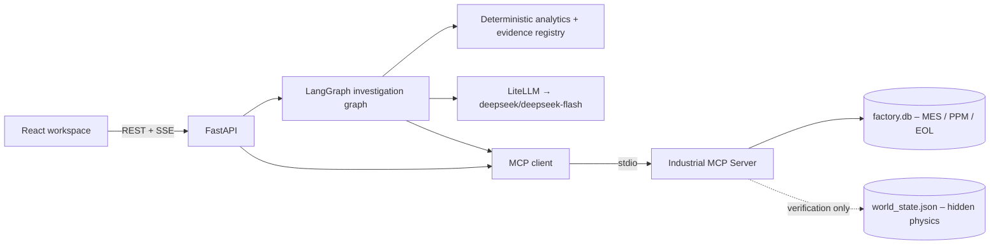
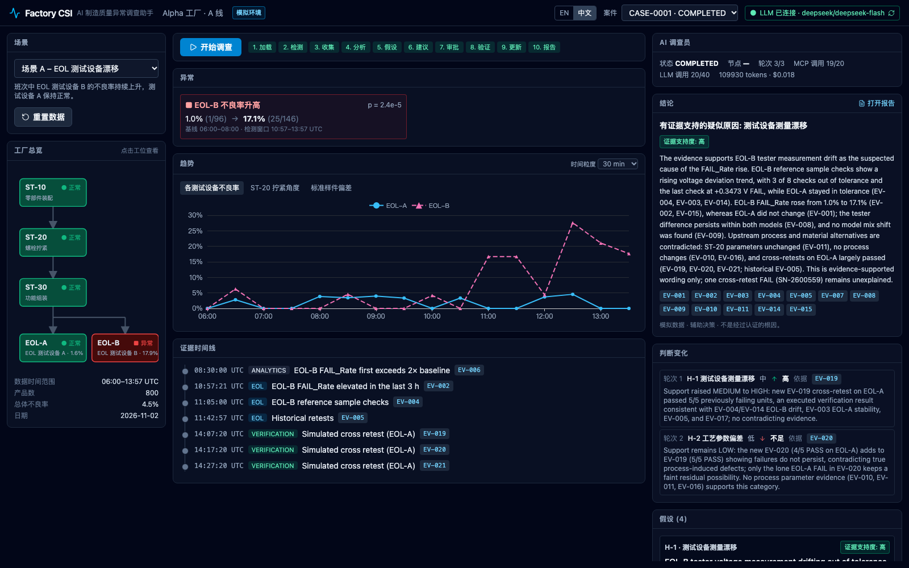

# Factory CSI – AI Manufacturing Quality Investigation Copilot

**Kiroween 2026 · Category: Frankenstein.** Factory CSI stitches together industrial data systems (MES, equipment monitoring, EOL test), the Model Context Protocol, deterministic statistical quality analytics, an LLM agent and human-in-the-loop verification. Starting from one quality anomaly, it collects cross-system evidence, proposes **what to verify next**, runs that check after an engineer approves it, revises its judgment, and writes a traceable report.

> Everything runs on a fictional factory (Factory Alpha, Line A) with generated data. Verifications are simulated. Results are decision support, not certified root causes.



## The problem

When the EOL (end-of-line) defect rate of one tester jumps from about 2 % to about 18 %, a quality engineer has to query MES, equipment monitoring and EOL test systems separately, export data, and correlate serial numbers, recipe versions and reference-sample checks by hand. The cause can be a real product defect, a drifting tester, or a change in product mix that only looks like a defect. A wrong early verdict is expensive: scrapping good parts or shipping bad ones.

## What Factory CSI does

1. **Cross-system manufacturing forensics.** An Industrial MCP Server exposes the simulated MES / PPM / EOL systems as 8 tools. The agent queries them, and every call is visible live in the UI.
2. **Evidence-grounded investigation.** Statistics such as Fisher's exact test, KS / Mann–Whitney tests, OLS trends, model stratification and mix shift are computed by deterministic Python. Each finding becomes an Evidence item (`EV-007`) that resolves to raw records. The LLM can only cite existing Evidence IDs. Support levels (High / Medium / Low / Insufficient) are rule-checked: *High* requires a verification result.
3. **Next Best Verification.** The agent ranks up to 3 simulated verifications (cross retest on the other tester, reference sample check, process configuration audit) and states how each outcome would support or contradict each hypothesis. The engineer approves, rejects (with a reason) or concludes. The result becomes new evidence, and the agent records a before → after judgment change that cites it.



## How it works



The graph runs these nodes: `load_case → detect_anomaly → collect_evidence (fixed MCP queries + LLM tool loop) → analyze_evidence → generate_hypotheses → propose_verification → human_approval (interrupt) → execute_verification → update_hypotheses → … → finalize_conclusion → generate_report`.

- The answer key (`ground_truth.json`) is written by the simulator for tests and evaluation only. Import-linter contracts guarantee that `backend` and `industrial_mcp` cannot import it.
- The hidden world state is read only by the MCP verification engine.
- Per-case budgets are enforced in code: 20 MCP calls, 40 LLM calls, 3 verification rounds, 2 reject-alls.
- **No fallback mode:** if the LLM is unavailable, investigation is disabled and the UI says so. No canned text is ever shown as model output.

Details: [docs/architecture.md](docs/architecture.md).

## Scenarios

| Label | What the engineer sees |
|---|---|
| Baseline – Normal Operation | ~2 % EOL defects on both testers |
| Scenario A – EOL Tester Drift | EOL Tester B defect rate climbs during the shift while Tester A stays normal |
| Scenario B – Manufacturing Process Defect | Both EOL testers report more defects in the second half of the shift |
| Scenario C – Insufficient Evidence | EOL Tester B shows a higher defect rate, but key verification data is missing |

Each scenario is generated from a fixed seed (about 800 products, one 8-hour shift). The agent never sees these labels.

## Quick start (Docker)

```bash
cp .env.example .env          # put your LLM key into LLM_API_KEY (DeepSeek by default)
make docker-up                # = docker compose up --build
open http://localhost:8080
```

The backend generates the four datasets on first start. Without a key the app still runs: overview and statistics work, and AI investigation is disabled.

If Docker Hub, PyPI or npm are slow where you are, you can override the base images and package registries through environment variables, e.g. `NODE_IMAGE=docker.m.daocloud.io/library/node:22-alpine NGINX_IMAGE=docker.m.daocloud.io/library/nginx:1.27-alpine UV_DEFAULT_INDEX=https://pypi.tuna.tsinghua.edu.cn/simple NPM_REGISTRY=https://registry.npmmirror.com/ make docker-up`.

## Local development

```bash
make setup          # uv sync + npm ci  (needs uv, Node ≥ 20)
make seed           # generate data/ds-00..ds-03
make dev-backend    # terminal 1: http://127.0.0.1:8000 (API docs at /api/docs)
make dev-frontend   # terminal 2: http://localhost:5173
```

The UI is available in **English and Simplified Chinese** (EN / 中文 switch in the top bar, or `?lang=zh` in the URL). AI-generated text (hypotheses, rationales, report narrative) is produced in English.



Demo path: choose **Scenario A** → **Reset dataset** → **Start Investigation** → watch MCP calls and evidence → **Approve Verification** on the cross retest → see the judgment change → **Conclude** → **Open report** (download Markdown or print to PDF).

## Configuring the LLM

`LLM_MODEL` is a [LiteLLM](https://docs.litellm.ai/) model string, so switching provider means editing `.env` only. `.env.example` has ready-made blocks for DeepSeek, OpenAI, Gemini, Qwen (DashScope), OpenRouter and Ollama. Default: `deepseek/deepseek-flash` with thinking disabled. One investigation takes about 15–20 LLM calls, roughly 60–100 s and about US$0.01–0.02.

## Tests and evaluation

| Command | What it runs |
|---|---|
| `make test-fast` | 66 deterministic pytest tests (simulator, MCP over real stdio, backend logic, API), import contracts, 11 Vitest tests, TypeScript check. No key or network needed. |
| `make test` | The above plus 4 real-LLM investigation tests (`tests/llm`, a few cents) |
| `make eval` | The [evaluation harness](docs/evaluation.md): N real investigations per scenario scored against the hidden ground truth |
| `make check-submission` | Pre-submission compliance checklist |

## Project structure

```
factory_data/   shared schema, ids, UTC time, physics, world-state models, append API
simulator/      scenario generator, registry, reset, CLI (simulator.ground_truth = answer key)
industrial_mcp/ MCP server: queries/ (read tools) and verification/ (simulated checks)
backend/        llm/ analytics/ evidence/ agent/ mcp_client/ store/ api/
evaluation/     evaluation harness
frontend/       React + TypeScript workspace
.kiro/          specs, steering, hooks, MCP settings (how this project was built with Kiro)
```

## Kiro

The project was built in Kiro IDE with 7 specs (`.kiro/specs/`), steering files, three working hooks (tests on save, typecheck on save, secret guard) and the Industrial MCP Server registered as a dev-time MCP server for Kiro's own agent. The dev-time path (Kiro's agent → `.kiro/settings/mcp.json` → server) is separate from the runtime path (backend → one stdio session per dataset); both use the same server code. See [KIRO_USAGE.md](KIRO_USAGE.md) and [docs/dev-log.md](docs/dev-log.md).

## Safety and limitations

- Fictional factory and generated data only. It contains no real company data, trademarks or logs.
- Verifications are simulated and require an explicit human approval. No code path controls real equipment.
- Conclusions are decision support labelled "suspected" or "evidence-supported", never a certified root cause.
- The evaluation covers 3 synthetic scenarios generated by this project and is not evidence of production-grade accuracy.
- The local demo has no authentication and binds to 127.0.0.1. A public deployment needs auth, HTTPS, key protection and rate limits.

## License

MIT – see [LICENSE](LICENSE).
