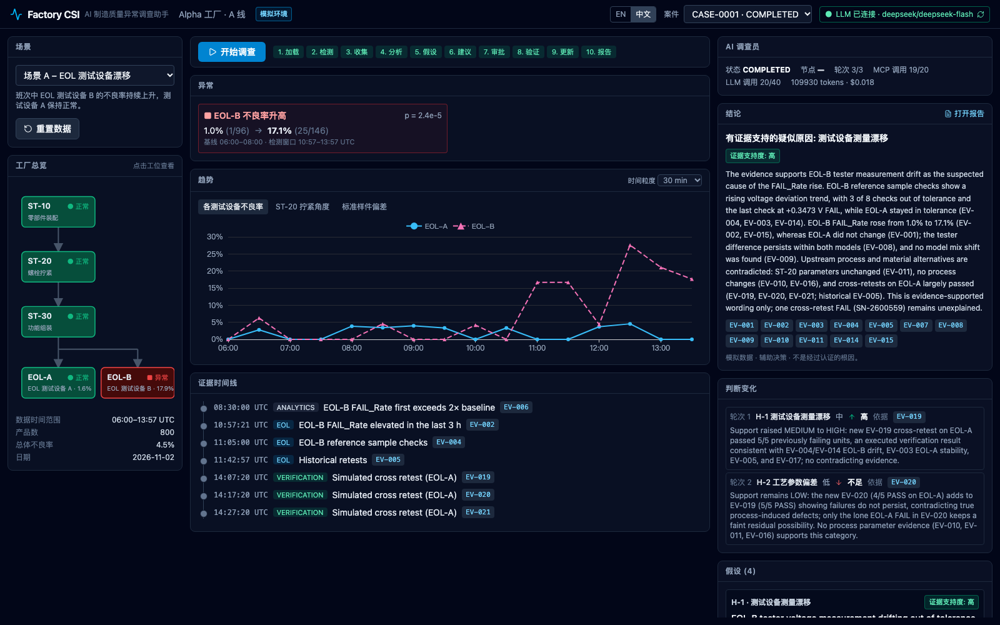

# Factory CSI – AI 制造质量异常调查助手

[English](README.md) · **简体中文**

> AI 制造质量调查助手：通过 MCP 跨 MES、设备与测试系统取证，主动提出下一步最佳验证，经工程师批准后执行并修正判断，输出可追溯的调查报告。

**Kiroween 2026 · 参赛类别：Frankenstein。** Factory CSI 把工业数据系统（MES、设备监控、EOL 测试）、Model Context Protocol、确定性的统计质量分析、LLM Agent 和人工确认的验证环节拼接成一个新应用。它从一个质量异常出发，跨系统收集证据，提出**下一步该验证什么**，经工程师批准后执行，再修正自己的判断，最后输出一份可追溯的报告。

> 所有内容都运行在一个虚构的工厂（Alpha 工厂 A 线）上，数据均为程序生成，验证均为模拟。结果仅用于辅助决策，不是经过认证的根因结论。



## 要解决的问题

当某台 EOL（下线）测试设备的不良率从约 2% 突然涨到约 18% 时，质量工程师需要分别查询 MES、设备监控和 EOL 测试系统，导出数据，再手工关联序列号、配方版本和标准样件检测记录。原因可能是产品真的坏了，也可能是测试设备漂移，还可能只是产品型号构成变了，看起来像缺陷。过早下错结论代价很高：要么报废好件，要么放行坏件。

## 核心功能

1. **跨系统取证**：自建的工业 MCP 服务把模拟的 MES、设备监控、EOL 系统封装成 8 个工具，AI 每一次调用都实时显示在界面上。
2. **用证据说话**：统计计算全部由确定性的 Python 代码完成，包括 Fisher、KS、Mann–Whitney 检验，OLS 趋势，按型号分层和型号构成变化。每个发现生成一条证据（如 `EV-007`），可以追溯到原始记录。AI 只能引用已有的证据编号。支持度（高 / 中 / 低 / 不足）由规则校验："高"必须有验证结果支撑，"中"及以上必须有直接体现机理的证据。
3. **下一步最佳验证**：AI 给出最多 3 项排好序的模拟验证（换另一台设备交叉复测、标准样件检测、工艺配置核查），并说明每种结果会支持或否定哪个假设。工程师可以批准、全部拒绝（需写理由）或结束调查。验证结果成为新证据，AI 随后记录明确的判断变化，例如"测试设备漂移：中 → 高，依据 EV-019"。
4. **可追溯报告**：报告共 10 个章节，包括时间线、证据、验证步骤、判断变化和疑似受影响的产品范围，可以下载 Markdown 或打印成 PDF。

## 三个场景

| 场景 | 工程师看到的现象 | AI 的典型结论 |
|---|---|---|
| 基线 – 正常运行 | 两台测试设备的不良率均约 2% | 未检测到异常 |
| 场景 A – EOL 测试设备漂移 | B 设备不良率持续上升，A 设备正常 | 复测通过、标准样件超差 → 测试设备漂移（高） |
| 场景 B – 制造工艺缺陷 | 班次后半段两台设备的不良都增加 | 配置核查与批准版本不一致 → 工艺参数偏差（高） |
| 场景 C – 证据不足 | B 设备不良率偏高，但缺少关键验证数据 | 只给出"疑似型号构成变化（中）"，不会断定是设备或工艺问题 |

AI 看不到场景名称，只能通过正常的数据接口获取证据。

## 快速开始（Docker）

```bash
cp .env.example .env          # 在 LLM_API_KEY 中填入密钥（默认 DeepSeek）
make docker-up                # 等价于 docker compose up --build
open http://localhost:18473
```

默认端口：网页 **18473**，后端 API **18474**，都只绑定在 127.0.0.1，可以用 `CSI_WEB_PORT` / `CSI_API_PORT` 修改。首次启动时会自动生成 4 个数据集。没有 Key 也能运行：总览和统计照常可用，AI 调查功能禁用，也不会显示任何预设文本。

如果当前网络访问 Docker Hub、PyPI 或 npm 较慢，可以通过环境变量换成镜像源，例如：
`NODE_IMAGE=docker.m.daocloud.io/library/node:22-alpine NGINX_IMAGE=docker.m.daocloud.io/library/nginx:1.27-alpine UV_DEFAULT_INDEX=https://pypi.tuna.tsinghua.edu.cn/simple NPM_REGISTRY=https://registry.npmmirror.com/ make docker-up`

界面右上角可以切换 **EN / 中文**，也可以在网址后加 `?lang=zh`。AI 生成的文字（假设、理由、报告正文）目前是英文。

## 本地开发

```bash
make setup          # uv sync + npm ci（需要 uv 和 Node ≥ 20）
make seed           # 生成 data/ds-00..ds-03
make dev-backend    # 终端 1：http://127.0.0.1:18474（API 文档：/api/docs）
make dev-frontend   # 终端 2：http://localhost:5173
```

演示路径：选择**场景 A** → **重置数据** → **开始调查** → 观察 MCP 调用和证据 → 对交叉复测点**批准验证** → 查看判断变化 → **结束调查** → **打开报告**。

## 配置 LLM

`LLM_MODEL` 是 [LiteLLM](https://docs.litellm.ai/) 的模型字符串，换模型只需修改 `.env`。`.env.example` 里预置了 DeepSeek、OpenAI、Gemini、通义千问（DashScope）、OpenRouter 和 Ollama 的示例配置。默认使用 `deepseek/deepseek-flash`，关闭思考模式。一次调查约 12–18 次 LLM 调用，耗时约 1 分钟，花费约 0.012 美元。

## 项目故事

**灵感**：EOL 测试设备不良率从 2% 涨到 18% 时，难点在于判断是产品坏了、设备漂移了，还是型号构成变了，而相关证据分散在多个系统里。我们想要一个能说清"下一步查什么"、并会根据证据修正判断的助手。

**构建方式**：
- 用 Kiro 做规格驱动开发：7 个 Spec，144 条 EARS 需求，并做了跨 Spec 一致性检查。
- Steering 规则和三个 Hook：保存时跑测试、保存时做类型检查、保存时扫描密钥。
- 可复现的模拟器，标准答案在代码层面无法被 Agent 导入。
- 工业 MCP 服务，以及用 `interrupt()` 实现人工审批的 LangGraph Agent。
- 写在代码里的护栏：引用校验、支持度规则、机理证据、调用预算、禁止兜底文本。

**挑战**：
- 设计既能被检测出来、又确实存在歧义的场景。
- 第一次评测后，在代码层面阻止 LLM 在没有机理证据时给出"中"。
- 适配 MCP SDK 2.x 和 LangGraph 1.x。
- 处理真实运行中发现的 bug，例如事件流一直不关闭。

**收获**：让代码负责计算、模型负责解释。"下一步做这项检查，每种结果意味着什么"比"根因就是 X"更有用。

完整的中英文项目故事（含公式）见 [docs/submission.md](docs/submission.md)。

## 测试与评测

| 命令 | 内容 |
|---|---|
| `make test-fast` | 66 个确定性 pytest 测试（模拟器、真实 stdio 下的 MCP、后端逻辑、API）、import 隔离规则、11 个 Vitest 测试和 TypeScript 检查。不需要 Key，也不需要网络 |
| `make test` | 在上面基础上再加 4 个真实 LLM 调查测试（花费几美分） |
| `make eval` | [评测](docs/evaluation.md)：每个场景跑 N 次真实调查，对照隐藏的标准答案评分（最近一次 9/9 可接受） |
| `make check-submission` | 提交前的合规检查 |

## 项目结构

```
factory_data/   共享的表结构、ID、UTC 时间、物理模型、world state、追加写入接口
simulator/      场景生成器、注册表、重置、CLI（simulator.ground_truth 为标准答案）
industrial_mcp/ MCP 服务：queries/（只读工具）与 verification/（模拟验证）
backend/        llm/ analytics/ evidence/ agent/ mcp_client/ store/ api/
evaluation/     评测
frontend/       React + TypeScript 工作台
.kiro/          Spec、Steering、Hook、MCP 配置（用 Kiro 开发本项目的过程记录）
```

## Kiro 的使用

本项目全程在 Kiro IDE 中开发，用到了 7 个 Spec（`.kiro/specs/`）、Steering 文件、三个实际生效的 Hook，并把工业 MCP 服务注册给 Kiro 自己的 Agent，用于开发期调试。开发期的调用路径（Kiro Agent → `.kiro/settings/mcp.json` → 服务）与运行时的调用路径（后端 → 每个数据集一个 stdio 会话）相互独立，两者使用同一份服务代码。详见 [KIRO_USAGE.md](KIRO_USAGE.md) 和 [docs/dev-log.md](docs/dev-log.md)。

## 安全与局限

- 只使用虚构的工厂和生成的数据，不含任何真实企业的数据、商标或日志。
- 验证全部是模拟的，必须由人明确批准才会执行，系统中没有任何控制真实设备的代码路径。
- 结论仅用于辅助决策，标注为"疑似"或"有证据支持"，不是经过认证的根因。
- 评测只覆盖本项目生成的 3 个合成场景，不能证明达到生产级准确率。
- 本地演示没有身份认证，只绑定在 127.0.0.1。公开部署前需要加上认证、HTTPS、密钥保护和限流。

## 许可证

MIT，见 [LICENSE](LICENSE)。
