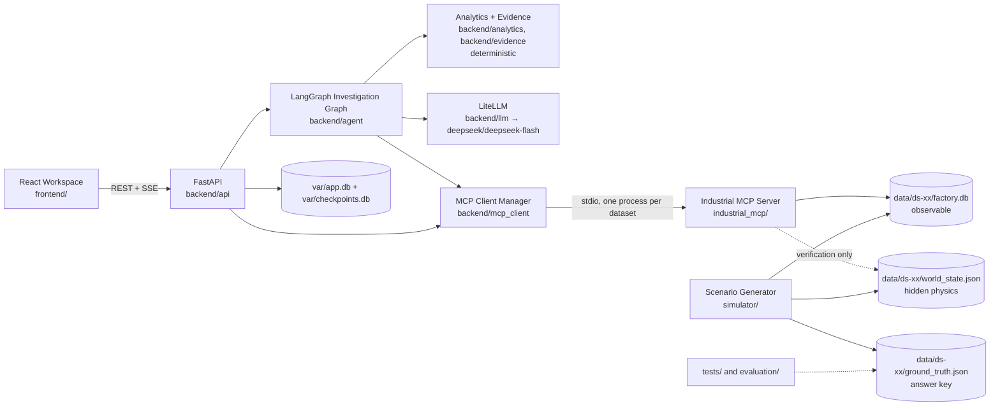
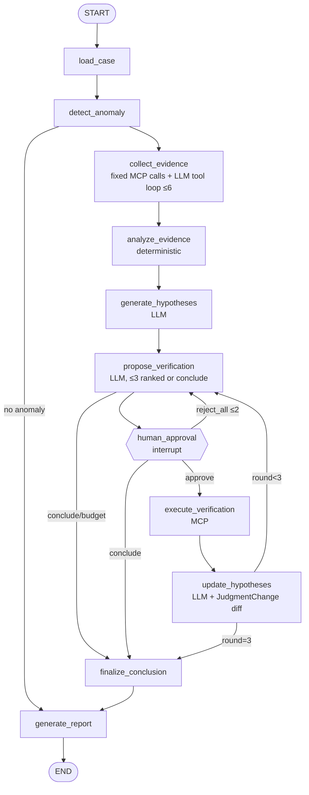

# Factory CSI – Architecture

Single source of technical design for all specs in `.kiro/specs/`. Each spec's `design.md` points here and lists only module-specific decisions. Requirements live in each spec's `requirements.md`.

## 1. System overview



Information isolation:

| Artifact | Written by | Readable by |
|---|---|---|
| `factory.db` | simulator, verification appends (industrial_mcp) | industrial_mcp only (backend goes through MCP) |
| `world_state.json` | simulator | `industrial_mcp.verification` only |
| `ground_truth.json` | `simulator.ground_truth` | tests, `evaluation/` |

Import contracts (import-linter, `pyproject.toml`): `backend`, `industrial_mcp` must not import `simulator.ground_truth` or `evaluation`; `factory_data` imports nothing from `simulator`, `backend`, `industrial_mcp`; `industrial_mcp.queries` must not import `factory_data.world_state` or `industrial_mcp.verification`.

## 2. Repository layout

```text
factory_data/      schema.py ids.py timeutil.py enums.py world_state.py append.py db.py
simulator/         config.py registry.py generator.py scenarios.py writer.py reset.py
                   summary.py hashing.py cli.py __main__.py ground_truth.py
industrial_mcp/    server.py __main__.py schemas.py errors.py calllog.py
                   queries/ (context, eol, traces, equipment, changes, refchecks, records)
                   verification/ (engine.py ledger.py)
backend/           settings.py
                   llm/ (client.py health.py structured.py tools.py redact.py)
                   analytics/ (anomaly.py comparisons.py process.py msa.py timeline.py stats.py)
                   evidence/ (registry.py citations.py models.py)
                   agent/ (state.py graph.py nodes_*.py prompts/ guards.py proposals.py report.py)
                   mcp_client/ (manager.py)
                   store/ (tables.py repo.py events.py)
                   api/ (app.py routes_*.py sse.py errors.py status_rules.py)
evaluation/        harness.py metrics.py report.py
frontend/          Vite + React + TS app
tests/             unit/ integration/ llm/ eval/
scripts/hooks/     run_related_tests.sh frontend_check.sh secret_guard.sh
data/ var/ logs/   generated, git-ignored
```

## 3. Virtual factory model

Factory Alpha, Line A. Stations `ST-10` (component assembly), `ST-20` (automatic bolt tightening), `ST-30` (functional assembly), `EOL`. Equipment ids equal the station id for manufacturing stations (`ST-10`, `ST-20`, `ST-30`); EOL station equipment `EOL-A`, `EOL-B`.

| Model | output_voltage limits (V) | midpoint | half-width |
|---|---|---|---|
| MODEL-A | 11.40 – 12.60 | 12.00 | 0.60 |
| MODEL-B | 4.75 – 5.25 | 5.00 | 0.25 |

Shift `2026-11-02T06:00:00Z`–`14:00:00Z`, 800 products (configurable 500–1000), ~36 s takt. Each SN: ST-10 (~30 s) → ST-20 (~35 s) → ST-30 (~30 s) → first EOL test. Products are released only while the full route fits inside the shift. Production orders of 50 units per model; material lot per order.

**Normalized measurement model.** All physics uses z = (value − midpoint) / half-width; limits are z = ±1.

```
angle_dev  = angle − 90.0°            angle ~ N(90 + program_shift, σ_angle = 2.0°)
true_z     = 0.05 · angle_dev + N(0, σ_product = 0.40)
measured_z = true_z + bias_tester(ts) + noise,   noise ~ N(0, 0.10)
```

Baseline FAIL_Rate ≈ 1.8 %. **No-flip rule:** measurement noise never changes the PASS/FAIL class of `true_z + bias`; a draw that would flip it is redrawn (deterministic RNG, at most 20 tries, then noise = 0). This makes FAIL ⇔ true value out of limits when bias is 0, and makes verification outcomes deterministic and explainable. Torque ~ N(12.0 N·m, 0.3) + 0.02 · angle_dev.

Tester bias: `bias(ts) = base + slope · max(0, hours since onset)`; baseline `base = 0`, no onset. Reference sample: nominal = midpoint of MODEL-A, measured = nominal + half-width · (bias + N(0, 0.05)), tolerance 0.25 (normalized) → result PASS/FAIL. Hourly checks at `shift_start + k h + 5 min`.

### Scenarios

| Dataset | Key | Injection | Expected verification outcomes |
|---|---|---|---|
| ds-00 | baseline | none | – |
| ds-01 | a | EOL-B bias slope 0.153 /h from 09:00 (≈0.77 at 14:00); 2–10 historical retests of affected EOL-B failures on EOL-A (PASS) | retest PASS · EOL-B ref OUT_OF_TOLERANCE · ST-20 config MATCH |
| ds-02 | b | 10:08 `process_changes` ST-20 program P-2.3 → P-2.4; angle mean +12°, σ 2.5° for P-2.4 steps | retest FAIL · ref WITHIN_TOLERANCE · ST-20 config MISMATCH |
| ds-03 | c | Window 09:00–14:00: Model B share 45 % (10 % before), 85 % of Model B and 35 % of Model A routed to EOL-B; Model B σ_product 0.767 (≈20 % defects), Model A 0.386 (≈1.5 %); no ref checks / retests / equipment events in window; EOL-B reference sample UNAVAILABLE ("out for calibration") with a maintenance event at 08:55 | ref (EOL-B) UNAVAILABLE · retest FAIL · config MATCH |

Registry default seeds are chosen (and fixed) so that every statistical acceptance criterion of the simulator spec holds; tests assert them.

## 4. Data model (`factory_data.schema`, SQLite, all timestamps UTC `YYYY-MM-DDTHH:MM:SSZ`)

| Table | Columns (PK first) |
|---|---|
| stations | station_id, name, sequence |
| equipment | equipment_id, station_id→stations, name, equipment_type |
| product_models | model_id, name, ov_lower, ov_upper |
| production_orders | order_id, model_id→, qty, start_ts |
| products | sn, order_id→, model_id→, material_lot, created_ts |
| process_steps | step_id, sn→, station_id→, equipment_id→, start_ts, end_ts, recipe_version, result |
| process_measurements | meas_id, step_id→, sn→, equipment_id→, ts, parameter (torque/angle), value, unit, program_version |
| equipment_events | event_id, equipment_id→, ts, event_type (state/alarm/maintenance/calibration), severity, details_json |
| process_changes | change_id, equipment_id→, ts, change_type, old_value, new_value, changed_by |
| eol_tests | test_id, sn→, tester_id→equipment, ts, model_id→, result (PASS/FAIL), failure_code, is_retest, retest_of→eol_tests, origin (historical/verification) |
| eol_measurements | meas_id, test_id→, test_item, value, lower_limit, upper_limit, result |
| reference_sample_checks | check_id, tester_id→equipment, ts, sample_id, test_item, nominal, measured, deviation, result, origin |

CHECK constraints enforce enums. Failure code constant `OV_OUT_OF_LIMIT`.

ID formats (mutually exclusive): `PO-123456`, `SN-1234567`, `PS-12345678`, `PM-12345678` / `PM-V1234567`, `EQE-123456`, `PC-12345`, `T-123456` / `T-V12345`, `RC-12345` / `RC-V1234` (`V` = verification origin, numbered from 1 after each reset).

App DB (`var/app.db`, `backend.store`): `cases`, `case_events (case_id, seq, type, payload, created_at)`, `evidence_items`, `hypotheses_snapshots`, `proposals`, `decisions`, `judgment_changes`, `reports`, `mcp_calls`, `llm_calls`, `dataset_epochs`. LangGraph checkpoints in `var/checkpoints.db`.

## 5. Industrial MCP Server

FastMCP, stdio, `python -m industrial_mcp --dataset ds-01 --data-dir data [--log-dir logs]`. Fresh SQLite connection per call (read-only for queries). Every response: `{call_id: "MCP-<seq>", dataset_id, ...}`; errors: `isError` result with JSON `{error_code, message, details, call_id, dataset_id}`, codes INVALID_ARGUMENT, NOT_FOUND, UNAVAILABLE, LIMIT_EXCEEDED, INTERNAL. Call log `logs/mcp/<dataset_id>.jsonl`.

| Tool | Input | Output (summary) | LLM-visible |
|---|---|---|---|
| get_factory_context | – | stations, equipment, models + limits, data_time_range, record_counts | yes |
| get_eol_summary | start, end, tester_id?, model_id?, bucket_minutes 15–240 (60) | totals, by_tester, by_model, by_tester_model, buckets per tester, top failure codes, retest summary, verification tests, failed_sn_sample ≤50 | yes |
| get_product_traces | serial_numbers 1–20 | per SN: product, steps, ST-20 measurements, all EOL tests + measurements; not_found | yes |
| get_equipment_events | equipment_id, start, end, event_types?, bucket_minutes, include_measurements=false | events, ST-20 param stats per bucket × program_version, step_counts, raw measurements ≤2000 | yes (raw forced off) |
| get_process_changes | start, end, equipment_id? | changes | yes |
| get_reference_sample_checks | tester_id, start, end | checks (explicit count 0) | yes |
| get_source_records | refs 1–50 `table:pk` | rows, not_found | no (API/UI) |
| run_simulated_verification | verification_type, params, approval_id, approved_by | simulation: true, verification_id, outcomes, created_refs, summary | no (execute node only) |

Verification: simulated clock `data_end + 10 min × k`, k = 1 + distinct verification timestamps in DB; noise seeded by SHA-256(registry seed, k, type, target); no-flip rule; rows appended via batch `factory_data.append` in one transaction; idempotency ledger `logs/mcp/verifications/<dataset_id>.jsonl` keyed by approval_id.

## 6. Investigation graph (`backend.agent`)



- detect_anomaly: baseline = first 2 h of data range, detection = last 3 h; per tester Fisher two-sided p < 0.01 and rate ≥ 2 × max(baseline, 0.5 %).
- Analyzers (MSA first): reference sample trend (OLS), historical retests, tester comparison, model stratification + mix shift, process change before/after (Mann–Whitney, KS), FAIL_Rate by program version, material lot, timeline.
- Evidence ids `EV-001…`, created only by code; summaries are templates; `data.ref_rows` keep key fields of referenced rows.
- LLM outputs (Pydantic): `HypothesisSet`, `ProposalSet`, `HypothesisUpdate`, `ConclusionDraft`, `ReportNarrative`. JSON mode + schema in prompt + validation; ≤2 repairs; citation validator; guardrails (HIGH needs verification evidence; no citations → INSUFFICIENT).
- Budgets per case: 20 MCP calls, 40 LLM calls, 3 verification rounds, 2 reject_all; closing reserve 6 LLM calls.
- Final conclusion: top-support hypothesis if ≥ MEDIUM and unique, else INSUFFICIENT_EVIDENCE. Wording "suspected" / "evidence-supported".
- Status: CREATED → RUNNING ⇄ AWAITING_APPROVAL → CONCLUDING → COMPLETED; FAILED_LLM (retryable), FAILED. Active = CREATED, RUNNING, AWAITING_APPROVAL, CONCLUDING.
- Checkpointer `AsyncSqliteSaver`, thread_id = case_id. No fallback text anywhere: LLM failure → FAILED_LLM.

## 7. Case event catalog (SSE `GET /api/cases/{id}/events`, `id` = seq)

status_changed, node_started, node_completed, mcp_call, llm_call, anomaly_detected, evidence_added, hypotheses_updated, support_downgraded, citation_dropped, awaiting_approval, proposal_rejected_by_validator, decision_recorded, verification_executed, verification_failed, judgment_changed, judgment_change_unattributed, conclusion_support_capped, conclusion_finalized, report_generated, budget_exhausted, error, audit, completed (last event; stream closes).

## 8. REST API (`backend.api.app:app`, prefix `/api`)

| Method | Path | Notes |
|---|---|---|
| GET | /health, /llm/status · POST /llm/status/refresh | LLM status OK / UNAVAILABLE / MISCONFIGURED |
| GET | /scenarios | registry labels (UI only) |
| POST | /datasets/{id}/reset | 409 if active case; bumps dataset epoch |
| GET | /datasets/{id}/overview, /equipment/{eid}, /trends?bucket_minutes= | all via MCP, case_id null |
| POST/GET | /cases, /cases/{id} | 503 LLM_UNAVAILABLE, 409 active case; detail has budgets, last_event_seq |
| GET | /cases/{id}/events | SSE, Last-Event-ID / ?after= |
| POST | /cases/{id}/decision | {action, proposal_id?, note?, actor?} → 202 |
| GET | /cases/{id}/evidence/{eid}, /mcp-calls, /report, /report.md | |
| POST | /cases/{id}/retry | FAILED_LLM only; 409 DATASET_CHANGED |

Error body `{"error": {"code", "message", "details"}}`. Equipment status rules: RED (flagged by detect_anomaly, or ST-20 program change with KS p < 0.01), ORANGE (alarm in last 60 min, failed ref check, or ≥2× baseline without significance), GREEN, GREY.

## 9. Frontend

React 18 + TS + Vite + Tailwind + shadcn/ui-style components + ECharts + TanStack Query + react-router + react-markdown. Layout: top bar (LLM indicator, case selector, SIMULATION badge), left Factory Overview (scenario select, reset, SVG line topology), center workspace (anomaly card, trend tabs, evidence timeline, progress stepper, Start), right AI Investigator (status line, MCP calls, evidence, hypotheses, Next Best Verification, judgment changes, conclusion), `/cases/:id/report`. SSE through `EventSource` + pure reducer with seq dedupe.

## 10. LLM configuration

`LLM_MODEL` is a LiteLLM model string (default `deepseek/deepseek-flash`); `LLM_API_KEY`, `LLM_BASE_URL`, `LLM_THINKING=false`, `LLM_TIMEOUT_S=60`. Switching provider = editing `.env` (e.g. `openai/gpt-4.1-mini`, `gemini/gemini-2.5-flash`, `openrouter/...`, `ollama/qwen3`). Key lives only in `.env` (git-ignored).

## 11. Delivery

`docker compose up --build` → frontend nginx on `127.0.0.1:8080` (proxies `/api`, SSE unbuffered), backend on `127.0.0.1:8000`; backend entrypoint generates missing datasets. `make test-fast` (no LLM), `make test` (real LLM), `make eval`, `make check-submission`.
